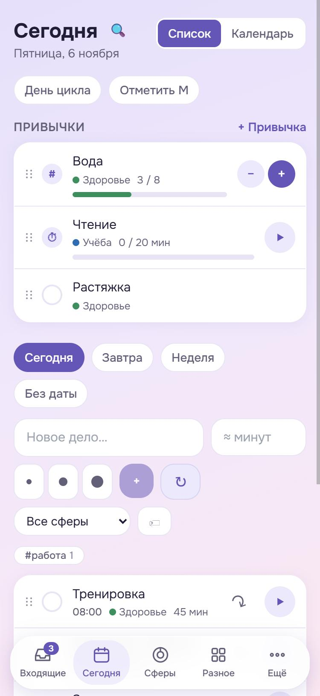
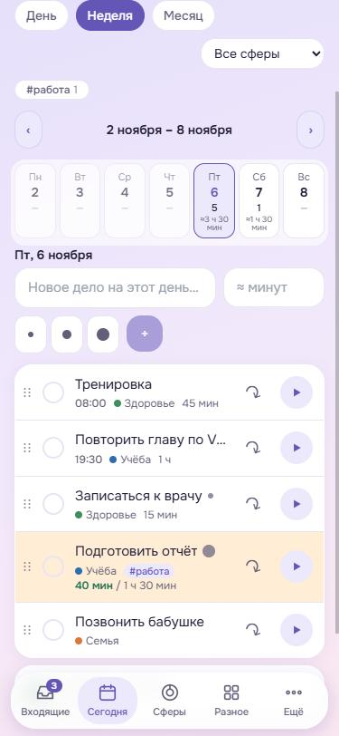
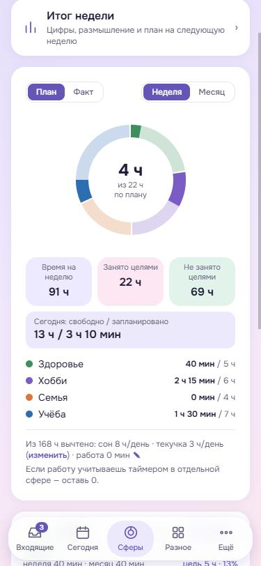
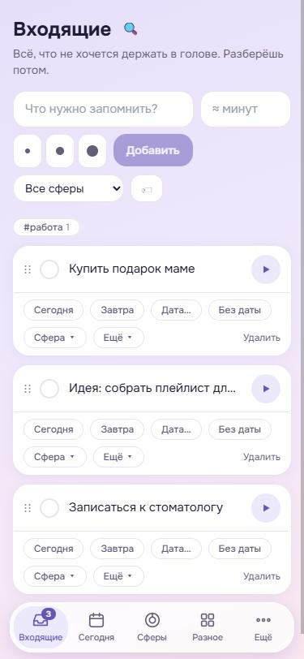

# KolaApp

Личный планировщик, в котором задачи, привычки и время собраны вместе. Он помогает разобрать всё, что крутится в голове, распланировать день и неделю и увидеть, куда на самом деле уходит время.

Работает как сайт и как приложение для Android. Интерфейс на русском.

<table>
  <tr>
    <td align="center"><br>Сегодня</td>
    <td align="center"><br>Неделя</td>
    <td align="center"><br>Сферы</td>
    <td align="center"><br>Входящие</td>
  </tr>
</table>

## Что внутри

Пять разделов внизу экрана:

| Раздел | Для чего |
|---|---|
| **Входящие** | Быстро записать всё, что пришло в голову, а потом разобрать: назначить дату, сферу, отложить или превратить в желание, книгу или фильм |
| **Сегодня** | Задачи и привычки на день, таймер и календарь: день с сеткой часов, неделя, месяц |
| **Сферы** | Здоровье, семья, хобби и другие области жизни: цели по времени, кольца «план» и «факт», итог недели |
| **Разное** | Библиотека, фильмы, ежемесячный чек-лист, желания |
| **Ещё** | Настройки, уведомления, резервная копия и восстановление |

Ещё в приложении есть:

- **Задачи:** подзадачи, теги, приоритет, сложность, повторы, бюджет, перенос на другой день.
- **Привычки:** отметка, счётчик или таймер, своё расписание.
- **Учёт времени:** таймер на задаче, привычке или сфере и ручная правка записей.
- **Планирование:** бюджет времени на неделю, предупреждение о перегруженном дне, итоги недели с планом на следующую.
- **Календарь цикла** с курсом таблеток: эти данные не уходят в Google Календарь и попадают в экспорт только по галочке.
- **Напоминания** на телефоне, в том числе без интернета, с кнопками «Выполнить», «Завтра» и «Перенести…».

Все подробности: [FEATURES.md](FEATURES.md).

## Как попробовать

Понадобится [Node.js](https://nodejs.org) версии 22 или новее.

```bash
git clone https://github.com/iamarrow88/life-planner.git
cd life-planner
git checkout dev
npm install
npm run dev
```

Открой в браузере http://localhost:5173.

Приложение запустится в **демо-режиме** с примерами данных. Регистрация не нужна, но всё хранится только в этом браузере и на другие устройства не попадёт. Сверху будет жёлтая плашка: это нормально.

## Как начать пользоваться по-настоящему

Чтобы данные хранились надёжно и были видны на всех устройствах, приложению нужна своя база. Подойдёт бесплатный проект Supabase.

1. Создай проект на [supabase.com](https://supabase.com).
2. Открой **SQL Editor** и один раз выполни весь файл [`supabase/scripts/planner_full_schema.sql`](supabase/scripts/planner_full_schema.sql).
3. Скопируй файл настроек:

   ```bash
   cp .env.example .env
   ```

4. Впиши в `.env` значения `VITE_SUPABASE_URL` и `VITE_SUPABASE_ANON_KEY` из **Project Settings → API**. Нужен публичный ключ (anon или publishable), а не секретный. Кавычки не нужны.
5. Если приложение только для тебя, в **Authentication → Providers → Email** можно отключить подтверждение почты.
6. Перезапусти `npm run dev`, открой приложение и зарегистрируйся.

Если подключиться не удалось, жёлтая плашка подскажет, какого значения не хватает.

## Как выложить сайт

Сайт собирается и выкладывается на GitHub Pages сам при каждой отправке в ветку `dev`.

1. В своей копии репозитория открой **Settings → Pages** и в **Source** выбери **GitHub Actions**.
2. В **Settings → Secrets and variables → Actions** добавь `VITE_SUPABASE_URL` и `VITE_SUPABASE_ANON_KEY`.
3. Отправь изменения в ветку `dev`.

Сайт можно установить на телефон или компьютер как приложение (PWA). Для другого хостинга собери проект командой `npm run build` и выложи папку `dist`: нужен HTTPS.

## Приложение для Android

Понадобятся Android Studio и JDK 21: с Java 25 сборка не работает. На телефоне нужен Android 7 или новее.

Подключи телефон по USB с включённой отладкой и выполни:

```bash
npm run release
```

Команда отправит коммиты на GitHub, соберёт APK в `release/KolaApp.apk` и установит его на телефон. Незакоммиченные изменения её остановят.

| Параметр | Что делает |
|---|---|
| `npm run release -- --no-push` | не отправляет на GitHub |
| `npm run release -- --no-install` | не устанавливает на телефон |
| `npm run release -- --dirty` | собирает вместе с незакоммиченным |

Чтобы работать в Android Studio, выполни `npm run android`, а затем `npm run android:open`.

## Что можно подключить дополнительно

Всё основное работает и без этого. Нужны серверные функции из папки `supabase/functions`, их секреты и расписание.

| Возможность | Функция | Секреты |
|---|---|---|
| Push-напоминания на сайте | `send-reminders` | `VAPID_PUBLIC_KEY`, `VAPID_PRIVATE_KEY`, `VAPID_SUBJECT`, `CRON_SECRET` |
| Синхронизация с Google Календарём | `google-sync` | `GOOGLE_CLIENT_ID`, `GOOGLE_CLIENT_SECRET`, `CRON_SECRET` |
| Быстрый ввод с часов | `capture` | нет отдельных, ключ создаётся в разделе «Ещё» |

Пошаговые инструкции: [PUSH.md](PUSH.md) и [GOOGLE.md](GOOGLE.md). Приложению для Android настройка push не нужна: там напоминания ставятся в сам телефон. Google Календарь подключается на сайте, синхронизация потом работает и в приложении.

## Резервные копии

На бесплатном тарифе Supabase автоматических копий нет. Раз в месяц делай копию: **Ещё → Скачать всё · JSON**. Восстанавливается она там же.

Что делать, если сломался компьютер или пропал проект: [RECOVERY.md](RECOVERY.md).

## Для разработчиков

Vue 3, TypeScript, Pinia, Tailwind CSS, Vite; Supabase (Postgres, вход, Edge Functions); Capacitor для Android.

| Где | Что |
|---|---|
| `src/views`, `src/components` | экраны и компоненты |
| `src/stores/app.ts` | состояние приложения |
| `src/data` | работа с данными: Supabase и демо-режим |
| `supabase/scripts` | SQL: полная схема и отдельные обновления |
| `supabase/functions` | серверные функции |
| `android` | приложение для Android |

Новый SQL сохраняй файлом в `supabase/scripts`, а затем обнови полную схему: см. [RECOVERY.md](RECOVERY.md). Если твоя база создана раньше, выполни только новые файлы из этой папки.

В планах: офлайн-режим.
